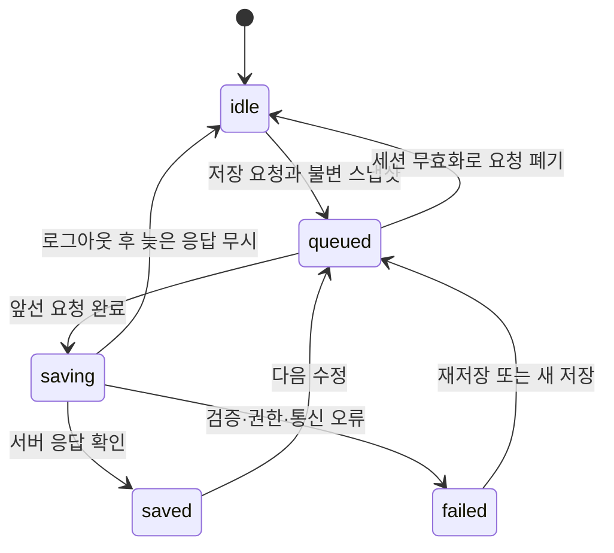

# Nudema 상태 머신 감사 · 2026-11-17

이 감사는 저장소가 소유한 고객 화면, PC·모바일 관리자, 공통 브라우저 스크립트,
Cloudflare Functions, DB 세션·주문 관계를 검토했다. 단순한 `status` 필드뿐 아니라
불리언 조합, DOM 표시 여부, URL, 타이머, 비동기 요청과 외래키에 숨어 있는 전환도 포함한다.
생성된 DC 런타임과 외부 라이브러리·브라우저·Google 내부 구현은 범위 밖이다.
정적 검토에서 식별한 논리적 단위의 목록이며, 실제 사용 중 발생할 모든 경로를 증명한 것은 아니다.

기계 판독용 원본은 [docs/state-machines.json](docs/state-machines.json)이다.
각 항목은 소스, 상태, 이벤트, 지켜야 할 조건, 우선순위, 이번 결정이 있다.
`retain-tested`는 전면 리팩터링을 보류했다는 뜻이다. 모든 개별 전이를 새로 테스트했다는 뜻은 아니다.

## 핵심 결정

전면적인 프레임워크 교체보다 비동기·영속성 경계부터 명시적으로 보호한다.
화면의 기존 로컬 데모와 동기 API를 유지하고, 실제 서버 완료를 별도로 관찰할 수 있게 한다.
인증·읽기·저장은 서로 독립적인 상태다. 저장 오류를 로그아웃으로 해석하거나,
다른 항목의 성공으로 이전 실패를 지우지 않는다.

| 변경 | UX | DX | AX |
|---|---|---|---|
| 관리자 저장 FIFO + 리소스별 결과 | 연속 저장의 순서 역전 방지, 실패 후 재전송 | `writeAsync()`로 서버 응답 대기 가능 | `inspect()`와 DOM 상태로 완료 여부 확인 |
| 서버 완료 표시 + 이탈 보호 | 전송 중·실패·완료 구분 | 기존 낙관적 편집기 유지 | 고정 시간 sleep 대신 상태 확인 |
| 주소 검색·관리자 목록 최신 응답만 반영 | 오래된 결과·오류가 선택이나 탭을 덮지 않음 | 요청 소유권을 명시 | `data-search-state`, `data-selection-state`, `data-state`, `aria-busy` |
| 주문 UPSERT와 생성 트랜잭션 | 상태 수정 후에도 회원 주문 내역 유지 | 부모 키·생성 시각 유지, 실패 시 롤백 | 격리 SQLite에서 전환과 외래키를 검증 |
| 취소 별칭·합산 재고 검증 | 취소 주문 통계 오류와 다중 행 우회 방지 | 기존 데이터 마이그레이션 없이 호환 | 같은 입력의 결과를 일관되게 검증 |

## 명시화한 전환과 계약



이 그림은 **리소스별** 저장 흐름이다. 전체 화면은 진행 중 요청이 있으면 우선 전송 상태를
표시하고, 모두 끝난 뒤 하나라도 실패하면 실패를 표시한다. 카탈로그와 상품 단독 쓰기도
같은 탭의 한 FIFO를 사용한다. 최신 제품 편집은 이전 카탈로그 응답의 캐시 반영보다 우선한다.

- `NudemaStore.write(name, value)`의 기존 boolean은 **로컬 캐시 성공**이다.
- `await NudemaStore.writeAsync(name, value)`는 원격 관리 화면에서 **서버 확인 성공**이다.
  로컬 데모에서는 로컬 저장 결과다. 양쪽 API를 같은 변경에 중복 호출하지 않는다.
- `catalog.saveAsync()`는 기존처럼 카테고리·연결 상품을 서버 확인 후 반영한다.
- 실패한 낙관적 쓰기의 스냅샷은 메모리에 보관하고 폴링 덮어쓰기를 막는다.
  ‘Дахин хадгалах’로 재시도할 수 있다. 다른 리소스의 성공은 이 실패를 지우지 않는다.
- HTTP 401·로그아웃은 세션 세대를 무효화한다. 대기 요청과 늦은 응답은 인증이나 캐시를 복구하지 못한다.
- 읽기·쓰기는 16초 뒤 중단한다. PUT 재전송은 같은 스냅샷을 쓴다.
  POST 주문의 결과 불명확 문제까지 해결한 것은 아니다.
- 이탈 확인은 전송 중이거나 재시도 가능한 실패가 있을 때만 브라우저가 제공한다.
  모바일 강제 종료·페이지 재로딩 후의 내구성 있는 오프라인 큐는 아니다.

주소는 검색 상태와 선택 상태가 병렬이다. 다른 검색어를 입력해도 기존 선택은 선택 해제 전까지
유지하며, 검색 결과를 받았다는 이유만으로 배송 위치를 바꾸지 않는다.
입력 변경·선택·삭제·컴포넌트 해제는 기존 요청을 무효화한다.
AbortSignal을 무시하는 응답도 소유권 검사로 차단한다. 지도 해제 시 마커와 지도 참조도 제거한다.

주문 저장은 기존 전체 교체 API를 유지하면서 기존 행을 UPSERT하고 실제로 생략된 주문만 삭제한다.
따라서 수정은 `user_orders` 연결을 유지한다. 신규 주문과 로그인 회원 연결은 한 D1 배치로 생성한다.
`cancel`과 `cancelled`는 같은 취소 상태로 읽되 과거 DB 값을 일괄 변경하지 않는다.

## 후속 우선순위와 필요한 결정

| 우선순위 | 발견한 경계 | 다음 변경·완료 기준 |
|---|---|---|
| P1 | 서로 다른 관리자·기기의 동시 저장 | 지금 FIFO는 **탭 내부만** 보호한다. 서버 리비전/ETag와 409 충돌 처리 필요. 특히 주문 전체 교체는 조회 이후 생성된 주문을 생략·삭제할 수 있으므로 단일 주문 PATCH로 전환해야 한다. |
| P1 | 주문 응답 유실 후 재결제 버튼 재시도 | 영속적인 idempotency key와 UNIQUE 인덱스, 동일 요청 재응답, 키 보관 기간을 도입해야 한다. 자동 POST 재시도는 추가하지 않았다. |
| P1 | 재고 예약·차감·취소 복원 | 이번에는 한 주문의 모든 행·옵션 수량을 합산한다. 별도 주문 간 재고 경쟁은 남아 있다. 주문 생성/입금 확인 중 언제 예약·차감할지, 미입금 만료·취소 시 언제 복원할지 결정 후 원자적 조건부 차감을 도입해야 한다. |
| P1 | 이미지 업로드 중 편집 대상 변경 | 업로드 완료 콜백이 현재 폼이나 배열 인덱스에 붙는다. 안정적인 블록 ID·폼 세대·업로드 취소를 함께 도입해야 한다. WebP 변환 검증은 유지했다. |
| P1 | 장바구니와 상품 변경 | 품절·삭제·옵션 제거·수량 감소·가격 변경을 현재는 숨기거나 자동 보정한다. 결제 전 변경 요약과 사용자 재확인 상태가 필요하다. |
| P1 | 결제·배송·취소 상태와 금액 이력 | 현재 관리자 상태 변경을 임의로 제한하지 않았다. 허용 역전/재배송·환불 정책을 정하고 서버에서 검사해야 한다. 가격 스냅샷이 없는 과거 주문은 현재 상품가로 대체되므로 과거 이력 보완이 필요하다. 신규 주문은 저장된 금액을 사용한다. |
| P1 | 매출·포인트 적립 | 취소 별칭은 수정했으나 미입금 주문의 합계·2% 포인트 계산은 기존 기준이다. 결제 완료/배송 완료 중 적립 시점을 합의해야 한다. |
| P2 | 편집 중 이탈과 중복 화면 구현 | 저장 큐 이전의 폼 초안·300ms 디바운스는 별도다. 명시적 dirty 초안과 이탈 보호, PC·모바일의 공통 로직 추출을 순차 적용한다. |
| P2 | 검색·마이페이지의 장애 화면 | 카탈로그 최초 로딩/진짜 검색 결과 없음과, 로그인 필요/일시적 계정 조회 실패를 각각 분리한다. 검색 입력이 폴링 응답으로 초기화되는 것도 방지해야 한다. |
| P2 | 로그인·회원가입 중복 제출 | 버튼 비활성화에 더해 동기 in-flight 가드와 요청 취소/세대 검사를 공통화한다. |
| P2 | 리뷰·이미지 수명 | 리뷰를 product ID로 연결·집계하고, 이미지 참조 계산과 유예 기간이 있는 고아 객체 정리를 설계한다. |
| P2 | 안내만 있는 서비스 | 회원 15% 할인·생일 쿠폰·이메일 알림·24시간 미입금 취소는 문구/설정에 비해 처리 경로가 없다. 실제 기능을 구현하거나 안내를 운영 사실에 맞춰야 한다. |

이 항목들은 ‘수정 완료’로 간주하면 안 된다. 이번 감사는 영업 정책, 재고/매출 장부,
운영 데이터를 추측해 바꾸지 않았다. 과거에 이미 사라진 회원–주문 연결도 이번 UPSERT만으로 복구되지 않는다.

SQL 선택은 Cloudflare의 [D1 JSON 함수 문서](https://developers.cloudflare.com/d1/sql-api/query-json/)에서
`json_each` 지원을 확인했다. D1 트랜잭션의 호출 계약은
[D1Database 문서](https://developers.cloudflare.com/d1/worker-api/d1-database/)를 따른다.

## 개발자·에이전트의 확인 방법

```js
// 읽기 전용 스냅샷. 원본 상태를 변경하지 않는다.
NudemaStore.inspect()
// { load, save, pending, authenticated, retryable, resources, trace }

// 애플리케이션/테스트 코드에서 현재 큐의 종료를 기다린다.
await NudemaStore.whenIdle()
```

`trace`는 최근 30개 저장 전환의 리소스·상태·리비전만 담는다. 사용자 이메일·이름·토큰·주문·계좌·
이미지·폼 본문은 넣지 않는다. 스냅샷을 수정해도 실제 상태는 변하지 않는다.
읽기용 진단 외에 새로운 관리자 권한 우회나 상태 수정용 디버그 API는 만들지 않았다.

브라우저 에이전트는 고객 데이터를 덤프하지 말고, 관리자 저장 표시의 `data-state`와 `aria-busy`,
주소 컴포넌트 상태, 현재 보이는 결과를 확인한다. 재저장은 실제 UI 버튼으로 수행한다.
카탈로그의 영업 데이터나 권한을 운영에서 임의로 변경하며 테스트하지 않는다.

```powershell
node --test .state-machines-test.js .admin-stability-test.js .catalog-test.js .address-test.js .account-test.js .google-auth-test.js .admin-auth-test.js .mobile-test.js .image-upload-test.js .serve-test.js
node .smoke-test.js
node .check-bindings.js
```

신규 회귀 검증은 응답 순서 역전, 다른 리소스의 성공 뒤 실패 유지, 불변 재전송, 로그아웃 후 응답,
진단 정보 노출, 주소 삭제/선택/해제 뒤 응답, 관리자 목록 탭 전환, 실제 SQLite 외래키와 롤백,
취소 별칭, 다중 행 재고 초과를 다룬다. 모든 네트워크와 DB 데이터는 격리된 테스트 fixture를 쓴다.

검증 결과: 기능 테스트 92개, HTTP 라우트 테스트 1개(26개 경로 포함), 기존 동작 검사 356개 통과.
템플릿 바인딩 누락 없음. 격리 localhost 브라우저에서 PC 저장 실패→재시도→완료→새로고침 유지,
모바일 관리자 저장 완료, 주소 검색→결과 선택을 확인했다. 운영 데이터 변경으로 테스트하지 않았다.

## 전체 목록

아래 표는 JSON 원본에서 생성한다. 상태·이벤트·불변 조건의 상세 내용은 JSON을 참조한다.

| ID | 소스 | 결정 | 우선순위 |
|---|---|---|---|
| runtime-bootstrap | user-ui.js, Nudema Admin.dc.html, Nudema Admin Mobile.dc.html, admin-team.js | retain-tested | P1 |
| environment-mode | nudema-store.js, serve.js, device-redirect.js | retain-tested | P2 |
| remote-load | nudema-store.js | hardened | P1 |
| admin-auth-view | Nudema Admin.dc.html, Nudema Admin Mobile.dc.html | retain-tested | P1 |
| admin-session | functions/_admin-auth.js, functions/api/admin/_middleware.js, functions/api/admin-auth/logout.js, nudema-store.js | hardened | P1 |
| customer-session | functions/_auth.js, functions/api/auth/login.js, functions/api/auth/logout.js | retain-tested | P1 |
| customer-google-oauth | functions/api/auth/google/start.js, functions/api/auth/google/callback.js, functions/_auth.js | retain-tested | P1 |
| admin-google-oauth | functions/_admin-google.js, functions/_admin-auth.js | retain-tested | P1 |
| credential-submission | Nudema Login.dc.html, Nudema Signup.dc.html, Nudema Account.dc.html, nudema-auth.js | follow-up | P2 |
| admin-membership | functions/_admin-team.js, functions/_admin-auth.js | retain-tested | P1 |
| admin-role-permissions | functions/_admin-team.js, functions/api/admin/_middleware.js, admin-team.js | retain-tested | P1 |
| team-list-load | admin-team.js | hardened | P1 |
| team-editor | admin-team.js | retain-tested | P2 |
| admin-write-queue | nudema-store.js, admin-team.js | hardened | P1 |
| catalog-transaction | nudema-store.js, functions/_catalog.js, functions/api/admin/catalog.js | hardened | P1 |
| product-editor | Nudema Admin.dc.html, Nudema Admin Mobile.dc.html | hardened | P2 |
| taxonomy-editor | Nudema Admin.dc.html, Nudema Admin Mobile.dc.html | retain-tested | P1 |
| content-autosave | Nudema Admin.dc.html, Nudema Admin Mobile.dc.html | hardened | P2 |
| settings-editor | Nudema Admin.dc.html, Nudema Admin Mobile.dc.html | hardened | P1 |
| image-conversion-upload | Nudema Admin.dc.html, Nudema Admin Mobile.dc.html, nudema-store.js, functions/api/admin/images.js | follow-up | P1 |
| image-object-lifecycle | functions/api/admin/images.js, functions/api/admin/images/[key].js, functions/api/images/[key].js | follow-up | P2 |
| review-moderation | Nudema Admin.dc.html, Nudema Admin Mobile.dc.html, Nudema Product.dc.html | follow-up | P2 |
| order-fulfilment | Nudema Admin.dc.html, Nudema Admin Mobile.dc.html, nudema-auth.js, functions/_order-state.js, functions/api/auth/account.js | hardened | P1 |
| order-account-persistence | functions/_lib.js, functions/api/orders.js, functions/api/auth/account.js | hardened | P1 |
| checkout-submission | Nudema Checkout.dc.html, nudema-store.js, functions/api/orders.js | follow-up | P1 |
| stock-and-reservation | functions/api/orders.js, nudema-cart.js | partially-hardened-policy-required | P1 |
| delivery-region-cascade | Nudema Checkout.dc.html, mn-regions.js | retain-tested | P2 |
| address-search | address-picker.js, functions/api/geocode.js | hardened | P1 |
| address-selection | address-picker.js, Nudema Checkout.dc.html, functions/api/orders.js | hardened | P1 |
| address-map-lifecycle | address-picker.js | hardened | P2 |
| cart-persistence | nudema-cart.js, Nudema Cart.dc.html | follow-up | P2 |
| cart-catalog-reconciliation | nudema-cart.js, Nudema Cart.dc.html, Nudema Checkout.dc.html | follow-up | P1 |
| product-availability | Nudema Product.dc.html | retain-tested | P1 |
| product-option-quantity | Nudema Product.dc.html, nudema-cart.js | retain-tested | P2 |
| product-gallery | Nudema Product.dc.html | retain-tested | P3 |
| product-detail-disclosure | Nudema Product.dc.html | retain-tested | P2 |
| catalog-search-filters | catalog-search.js, Nudema Search.dc.html, catalog-nav.js | follow-up | P2 |
| home-carousel | Nudema Mongolia.dc.html, Nudema Mobile.dc.html | retain-tested | P3 |
| home-curation | storefront-ui.js, Nudema Mongolia.dc.html, Nudema Mobile.dc.html | retain-tested | P2 |
| menu-drawers | nudema-menu.js, catalog-nav.js, Nudema Mobile.dc.html, storefront-ui.js | follow-up | P2 |
| account-view | Nudema Account.dc.html, functions/api/auth/account.js | follow-up | P2 |
| recently-viewed | storefront-ui.js | retain-tested | P3 |
| pwa-installation | pwa-install.js, manifest.webmanifest | retain-tested | P1 |
| service-worker-network | sw.js, offline.html | retain-tested | P1 |
| responsive-navigation | device-redirect.js, user-ui.js | retain-tested | P2 |
| footer-header-hydration | user-ui.js, storefront-ui.js | retain-tested | P2 |
| admin-navigation-dialogs | Nudema Admin.dc.html, Nudema Admin Mobile.dc.html | follow-up | P2 |
| ephemeral-feedback | storefront-ui.js, Nudema Checkout.dc.html, Nudema Admin.dc.html, Nudema Admin Mobile.dc.html | hardened | P2 |
| legacy-login-rate-limit | functions/api/admin-auth/login.js, functions/_lib.js | retain-tested | P2 |
| schema-initialization | functions/_lib.js, functions/_admin-auth.js, functions/_admin-schema.js, migrations | retain-tested | P1 |
